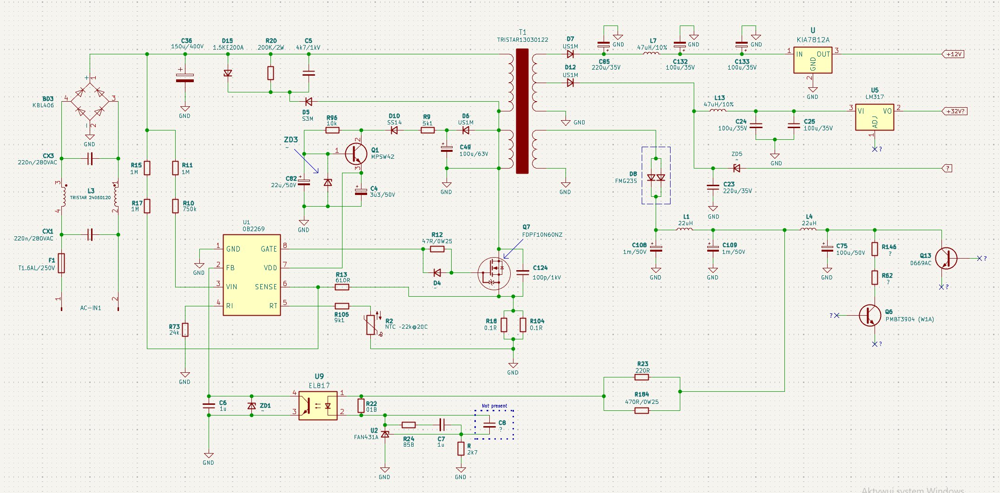
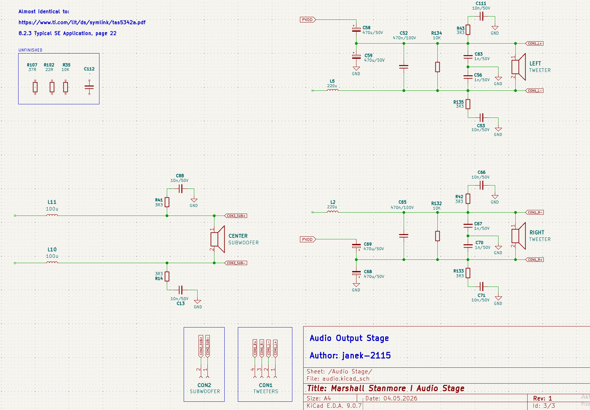

# Marshall Stanmore I - Power Supply Schematic

This repository contains a reverse-engineered schematic of the **power supply stage** for the **Marshall Stanmore I** speaker. 

Since Marshall does not release official service manuals or schematics for their products, repairing this board can be very difficult. This project aims to document the hardware to make repairs, troubleshooting, and modifications easier for the DIY and repair community.

## ⚠️ Safety Warnings

**READ BEFORE ATTEMPTING ANY REPAIRS!**
Working on Switch-Mode Power Supplies (SMPS) is dangerous. 
* ⚡ **Lethal Voltages:** The "HOT" side of this PCB operates at mains voltage (110V/230V AC) and rectifies it to **over 320V DC**. 
* 🔋 **Capacitor Discharge:** The main filter capacitor (**C36**, the large black capacitor near the high-frequency transformer) can hold a lethal 320V charge for a long time *even after the speaker is unplugged*. **Always discharge C36 using a bleeder resistor** (e.g., 2kΩ / 5W) and verify with a multimeter before touching the board.
* **Isolation:** Use an isolation transformer if you plan to probe the hot side with an oscilloscope.

## 📖 Origin & Credits

The foundational work for this schematic was done by **Josef Aichhorn** ([@juptec](https://www.mikrocontroller.net/user/show/juptec)), who shared his original hand-drawn schematics on a [mikrocontroller.net forum thread](https://www.mikrocontroller.net/topic/547728). Huge thanks and respect to Josef for this schematic. This board is covered in glue and is rather complex, making reverse-engineering incredibly tedious.

**My Contributions:**
* Redrew the entire schematic in KiCad 9 for better readability.
* Verified (most of the) connections against my board.
* Added some of the missing component values (resistors, capacitors, diodes).
* Added direct links to datasheets for most of the main components.

> **Disclaimer:** While care was taken to verify this schematic, both the original author and I could have simply *made mistakes*. Component values might also vary slightly between different hardware revisions. Use this schematic as a guide, not an absolute truth.

---

## ⚡Common Failure Points:

* **Fuse (F1)**
  * Often blows :).
* **The Current Mode PWM Switch (U1): [OB2269N](https://uploadcdn.oneyac.com/attachments/files/brand_pdf/hgsemi/D3/B0/OB2269N.pdf)**
  * PWM Switch. Drives the primary switching MOSFET, often burnt.
* **The main MOSFET (Q7): [FDPF10N60NZ](https://www.onsemi.com/pdf/datasheet/fdpf10n60nz-d.pdf)**
  * N-Channel, 600 V, 10 A, MOSFET, often burnt.
* **The Opto Coupler (U9): [EL817](https://w.electrodragon.com/w/images/2/27/EL817.pdf)**
  * Standard optocoupler, used to isolate feedback to the OB2269N.
* **Capacitor C34**
  * The 3u3, 50V electrolytic capacitor located next to the PWM Switch, often shorted or high ESR.
* **Capacitor C36**
  * The main 150u, 400V electrolytic capacitor, sometimes shorted or high ESR.
* **100W Audio Amp (U15) [TAS5342A](https://www.ti.com/lit/ds/symlink/tas5342a.pdf?ts=1777457999025)**
  * The main (and only) audio amp, legs sometimes burnt, along with the tracks.
* **The 12V Voltage Regulator (U?) [KIA7812A](https://www.alldatasheet.com/datasheet-pdf/pdf/85489/KEC/KIA7812AF.html)**
  * 12V regulator used to supply voltage for the Gate-drive (GVDD_x pins) of the audio amp. 
* **Any components surrounding the OB2269N**
  * This area of the board seems to be causing most of the problems present in the device.

---

## 🔍 My instance

* The speaker was non-responsive when I got it.
* The first thing I noticed, when I took it apart, was a burn mark on the heatsink of the Audio Amp **[TAS5342A](https://www.ti.com/lit/ds/symlink/tas5342a.pdf?ts=1777457999025)**.
* After investigating the issue, I found that one of the pins **(OUT_B)**  - along with the corresponding track - was burnt.
* I did some measurements and a couple of the pins of the IC were shorted. After removing the IC, the shorts were gone - which means the IC was toast.
* I tried to plug the speaker in, after removing the Audio Amp IC, but the fuse **(F1)** blew after a couple minutes of measurements.
* After removing most of the black glue and desoldering some of the components present in the SMPS section of the board, I measured 6.1 ohms on the **R20** resistor - which was marked for 200k ohms.
* Looking for the cause, I noticed that the **D5** [Rectifying Diode](https://www.mouser.pl/datasheet/3/175/1/ds16005.pdf) and the **D15** [TVS Diode](https://www.mouser.pl/datasheet/3/819/1/1.5KE-HF%20Series%20RevC.pdf) were both shorted.
* The rest of the components, MOSFET, driver IC, resistors and the electrolytic capacitors look fine.
* I have now removed D5 along with D15 and will order the replacements, as well as a replacement for the Audio Amp IC.
* I will give updates when the parts arrive.

## 🛠️ Update 1 (27.10.2026)
* I have successfully replaced the **D5** and **D15** diodes. 
* To test the power supply safely, I powered on the speaker **WITHOUT** the audio amplifier IC soldered in. I had to leave it out for now because the previous IC burned out and I still need to repair two damaged copper traces on the PCB.
* As a safety precaution, I powered the device with a 100W incandescent light bulb in series with the mains (dim bulb tester).
* **The device works!** The logic board boots up, I am able to switch between audio sources, and I even successfully connected my phone to the speaker via Bluetooth.
* I haven't tried powering the device directly from the wall without the series light bulb yet, but the bulb didn't glow at all during my tests, which is a great sign indicating there are no major shorts left on the board.
* Also, I have divided the schematic into the **power** stage and the **audio** stage. The audio stage is not finished, and probably never will be, since I have put the speaker back together, but maybe it will help somebody.
* Next step: I will repair the damaged traces, solder in the new audio amplifier, and post the final results soon!

## 🛠️ Update 2 (29.10.2026)
* I have soldered in the new Audio Amp **[TAS5342A](https://www.ti.com/lit/ds/symlink/tas5342a.pdf?ts=1777457999025)** and repaired the burnt tracks _([image](png/TSA5342A.jpeg))_.
* After powering the speaker on (still with the dim bulb limiter), it acted the same way it did before I installed the new amp. Everything was working, except... no sound.
* After measuring the voltages of the Audio Amp IC, I found that all of the GVDD_x pins were @ **4.3V**. That value seemed odd, so I checked the datasheet.
* The datasheet says that GVDD_x pins need at least 10.5V to function, typical is 12V.
* Because of the above, I checked the 12V linear regulator **[KIA7812A](https://www.alldatasheet.com/datasheet-pdf/pdf/85489/KEC/KIA7812AF.html)**. It was outputting the 4V.
* I checked it again with my lab power supply after desoldering it from the main board. It was drawing 200mA and still outputting 4V with 18V on the input, so it was obviously damaged.
* I replaced the **[KIA7812A](https://www.alldatasheet.com/datasheet-pdf/pdf/85489/KEC/KIA7812AF.html)** with a **[LM7812](https://www.alldatasheet.pl/datasheet-pdf/pdf/105712/FAIRCHILD/LM7812.html)**.
* After turning the speaker on, the sound finally worked, although there was some mysterious (very quiet) crackling (?) when no sound was playing.
* Also - the area around the audio amp was getting warm kind of fast. Which is, I guess, normal since there used to be a big-ass heatsink on top of the audio amp (I removed it to work on the PCB).
* I will try to stress-test the speaker and also power it on without the dim bulb limiter. I will give updates soon.
> The 12V regulator is located in the middle of the board, it's attached to a black heatsink. I don't know how it's marked, since it's surrounded by big capacitors.

## 📄 The Schematic

*(Click the image to view the full resolution)*

  

  

### Download:
* [High-Resolution Image (PNG)](png/power.png)

## 🤝 Contributing
Feel free to fork this repository and add more parts of the schematic.